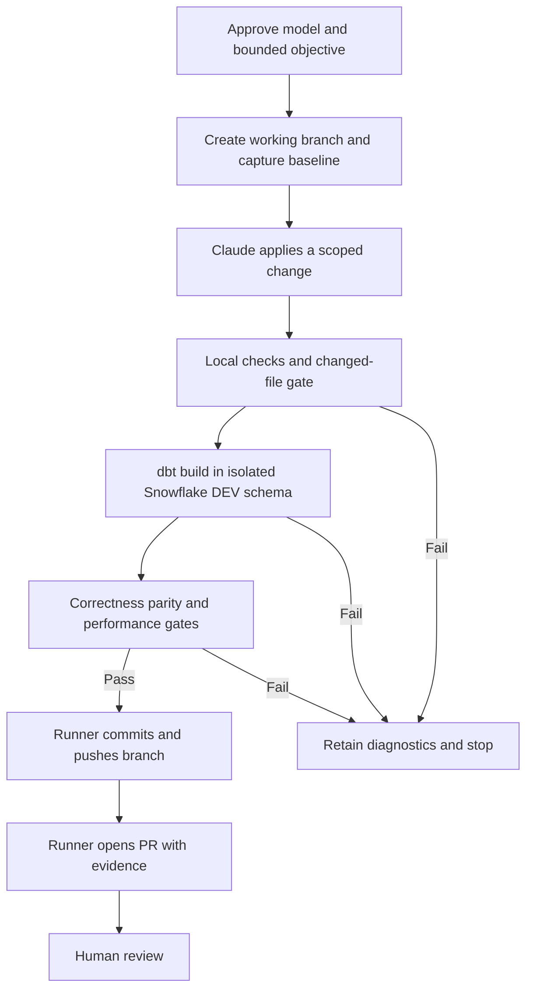

# claude -p harness

Runs `claude -p` headless with a bounded objective, a tool allowlist, a JSON schema, and a deterministic exit code. Python stdlib only.

## Run

    python3 run.py smoke                 # runner validation
    python3 run.py critical_path         # fixture-backed dbt critical path recommendation
    python3 run.py snowflake_profile     # same objective, data read live from Snowflake (read-only role)
    python3 run.py <workflow> [--cwd PATH] [--budget USD] [--timeout SEC]

Final stdout line: `run_id=<id> exit=<n> result=<path>`. Artefacts land in `runs/<run_id>/` (`argv.json`, `stdout.json`, `stderr.txt`, `result.json`, `summary.json`).

Tests (fake claude, no API calls): `python3 -m unittest discover -s tests -v`

## Exit codes

| Code | Meaning |
|---|---|
| 0 | Completed with schema-valid payload. Recommendation is on disk; stop for human. |
| 1 | claude failed: nonzero return, `is_error`, budget exhausted, or timeout. |
| 2 | claude ran but payload missing or schema-invalid. |
| 3 | Config error (workflow folder or file missing). |

## Safety

All flags live in `agent_runner/invoke.py:build_argv`: `--permission-mode dontAsk`, a per-workflow `--allowedTools` list when nonempty, write/web tools disallowed, `--max-budget-usd`, and a subprocess timeout. No `--bare`, no `bypassPermissions`. The harness does not use `--max-turns`; a separate GitHub headless test successfully used `--max-turns 1`.

`Read`, `Glob`, and `Grep` are also disallowed unless a workflow lists them.

**Permission rules are a guardrail, not a security boundary.** Claude Code auto-approves built-in read-only shell commands inside `--cwd` regardless of the `Bash(...)` allowlist. Tested on 2.1.308 with the exact `critical_path` argv: `cat probe.env` inside `--cwd` returned the file; `cat` outside `--cwd` was denied. `printenv VAR`, `env`, `echo $VAR`, and `cat /proc/self/environ` were all denied in the same setup, but treat that as observed behaviour of this version, not a guarantee. Rules:

1. Never place credentials (private key, `.env`, tokens) under `--cwd`.
2. Environment variables set for `run.py` are inherited by `claude` and its shell commands. Do not rely on env vars to hide secrets from the agent. Prefer a credential file outside `--cwd`, readable only by the tool's identity (separate OS user via `sudo -u`, or a secret store the agent's user cannot read).
3. Enforce least privilege at the target system (read-only Snowflake role, scoped dbt token). That is the control that holds if the permission rules fail. Verify it with real write probes, not one refused `CREATE DATABASE`: every role inherits `PUBLIC`, and on the trial account `PUBLIC` was granted `SNOWFLAKE_LEARNING_ROLE`, which let `CLAUDE_READONLY` create schemas and tables until it was revoked. Check `SHOW GRANTS TO ROLE PUBLIC`, then try `CREATE SCHEMA`, `CREATE TABLE`, `INSERT`, and `DELETE`. Known residual: with only `USAGE` on a schema, the role can still create session-scoped `TEMPORARY` tables. They vanish when the session ends and touch no persisted data.

## Snowflake setup (`snowflake_profile`)

`tools/snowflake_ro.py` runs one fixed query through `snow sql -c claude_ro`; its only input is an integer run id. It requires the Snowflake CLI (`snow`) on `PATH`, not a Python connector. The source table has no status column, so the tool reports `SUCCESS` when rows exist and `NOT_FOUND` otherwise.

Data: `DBT_DEMO.META.DBT_MODEL_TIMINGS`, loaded with the same five models as the `critical_path` fixture. This is a live Snowflake query over synthetic timings, not real dbt run metrics or query-plan profiling. The expected recommendation is `int_transactions`, on the chain `stg_events -> int_transactions -> fct_transactions -> rpt_finance`.

### Local authentication: key pair

Connection `claude_ro` in `~/.snowflake/connections.toml` (outside `--cwd`, `chmod 600`): key-pair auth (`SNOWFLAKE_JWT`) for a `TYPE = SERVICE` user `CLAUDE_SVC`, role `CLAUDE_READONLY`, warehouse `CLAUDE_WH`. The encrypted private key and passphrase stay outside the checkout. These local files are not committed or provisioned on GitHub runners.

### GitHub Actions authentication: OIDC

Verified on a GitHub-hosted Ubuntu runner with `snowflakedb/snowflake-actions@v3` (reported integration version v3.5.1). Snowflake authenticates GitHub's workload identity; no Snowflake private key or passphrase is required on the runner. Claude separately authenticates using the repository secret `CLAUDE_CODE_OAUTH_TOKEN`.

Registered on the Snowflake service user:

```sql
ALTER USER CLAUDE_SVC
ADD WORKLOAD IDENTITY github_actions
    TYPE = OIDC
    ISSUER = 'https://token.actions.githubusercontent.com'
    SUBJECT = 'repo:samabenojar@245874282/claude-agent-test@1435434978:ref:refs/heads/main';
```

That subject is specific to this repository and `main` branch. Other branch refs do not match it. Keep manual triggering and do not run untrusted pull-request code in a job with this identity.

The tested job uses `permissions: contents: read` and `id-token: write`, installs Claude Code, then configures Snowflake as follows:

```yaml
- name: Install Snowflake CLI and configure OIDC
  uses: snowflakedb/snowflake-actions@v3
  with:
    use-oidc: true
    oidc-token-name: SNOWFLAKE_CONNECTIONS_CLAUDE_RO_TOKEN

- name: Configure claude_ro Snowflake connection
  shell: bash
  env:
    SNOWFLAKE_ACCOUNT: ${{ secrets.SNOWFLAKE_ACCOUNT }}
  run: |
    set -euo pipefail
    mkdir -p "$HOME/.snowflake"
    cat > "$HOME/.snowflake/config.toml" <<EOF
    [connections.claude_ro]
    account = "${SNOWFLAKE_ACCOUNT}"
    user = "CLAUDE_SVC"
    role = "CLAUDE_READONLY"
    warehouse = "CLAUDE_WH"
    authenticator = "WORKLOAD_IDENTITY"
    workload_identity_provider = "OIDC"
    EOF
    chmod 600 "$HOME/.snowflake/config.toml"

- name: Test Snowflake connection
  shell: bash
  run: |
    set -euo pipefail
    snow connection test -c claude_ro
    snow sql -c claude_ro \
      -q "select current_user(), current_role(), current_warehouse();"

- name: Run snowflake_profile workflow
  shell: bash
  env:
    CLAUDE_CODE_OAUTH_TOKEN: ${{ secrets.CLAUDE_CODE_OAUTH_TOKEN }}
  run: |
    set -euo pipefail
    python3 run.py snowflake_profile --budget 1.00 --timeout 120

- name: Upload harness artefacts
  if: always()
  uses: actions/upload-artifact@v7
  with:
    name: claude-snowflake-profile-runs
    path: runs/
    if-no-files-found: warn
```

The OIDC action exports `SNOWFLAKE_CONNECTIONS_CLAUDE_RO_TOKEN`; it is inherited by `run.py`, Claude, and tool subprocesses. It is not hidden from the agent's process. Keeping configuration outside the checkout avoids ordinary repo reads, but is not OS-level credential isolation. Snowflake privileges remain the authorization boundary.

### Verification evidence

User-provided [GitHub Actions run](https://github.com/samabenojar/claude-agent-test/actions/runs/40475616531) completed successfully:

| Check | Observed result |
|---|---|
| Snowflake connection test | `Status OK`, user `CLAUDE_SVC`, role `CLAUDE_READONLY`, warehouse `CLAUDE_WH` |
| Harness run | `20261027T084814Z-54aad408`, exit `0` |
| Artefact upload | Five files uploaded as `claude-snowflake-profile-runs` |
| Downloaded `result.json` inspected | Run `847293`, `candidate_found`, recommended model `int_transactions`, expected four-model critical path |
| Run summary | Claude-reported cost USD `0.0251107`, duration `10694` ms (excludes Snowflake compute and job overhead) |

The downloaded ZIP was inspected: `result.json` matches the expected recommendation and chain, and `stdout.json` reports `is_error: false`. This verifies the answer, not which tool commands ran. The final `stdout.json` envelope contains no individual tool-call records; three turns and no permission denials do not prove tool usage. Use a separate `--output-format stream-json --verbose` invocation when that trace is needed.

Locally, the same workflow returned the expected model and chain; a separate stream-json run showed only the Snowflake tool command and the final structured-output tool. Persistent write probes against `DBT_DEMO` (`CREATE TABLE`, `INSERT`, `DELETE`, `CREATE SCHEMA`) were refused after removing the inherited learning role. Temporary-table creation remained permitted.

## Adding a workflow

Create `workflows/<name>/` with `workflow.json` (`{"allowed_tools": [...]}`), `prompt.md`, `schema.json`. The hand-rolled validator supports only `type`, `required`, `properties` primitive `type`, and `enum`.

## Minimal dbt project (`dbt_demo/`)

Five models reproduce the demo transformations using real dbt `source()` and `ref()` dependencies:

```text
DBT_DEMO.STAGING.STG_EVENTS (existing input table)
  -> stg_events -> int_transactions -> fct_transactions -> rpt_finance
dim_calendar (independent, 365 dates starting 2026-01-01)
```

Models are tables except `rpt_finance`, a view. Outputs go to the profile's DEV schema, not the source `STAGING` or existing `ANALYTICS` schema. Do not configure those source/demo schemas as the target. Synthetic timing metadata is not rewritten by dbt.

The source is named `staging`; `stg_events` references `source('staging', 'events')`. Set `DBT_SOURCE_DATABASE` and `DBT_SOURCE_SCHEMA` to read from a different input snapshot; defaults are `DBT_DEMO` and `STAGING`. The table identifier remains `STG_EVENTS`. These variables change only the input location, not the output schema or grants.

Local builds were verified with dbt Fusion `2.0.0-preview.193`. The GitHub workflow `.github/workflows/claude-headless-poc.yml` now runs the **dbt DEV Baseline** (not Claude): it explicitly pins dbt Core `1.12.6` and `dbt-snowflake` `1.12.4`, installs both together on Python 3.12, and runs `pip check`. Pinning only the adapter previously selected beta Core `1.13.0b1`. The harness remains Python stdlib-only; dbt is a separate executable dependency.

The downloaded GitHub baseline artefact was inspected: 5 models succeeded, all 18 tests passed with zero failures, and relations targeted `DBT_DEMO.CLAUDE_DBT_DEV`. That run used Core `1.13.0b1` and took 10.01 seconds; it is historical evidence, not verification of the new stable pins. This job uses GitHub environment `dbt-dev`, so its Snowflake OIDC subject must match that environment rather than the earlier recommendation job's branch-only subject.

The stable Core `1.12.6` / Snowflake adapter `1.12.4` pair was also smoke-tested locally against the DEV schema: `dbt parse` passed and a full `dbt build` completed with `PASS=23 WARN=0 ERROR=0 SKIP=0` (5 models, 18 tests).

### External profile

Copy `dbt_demo/profiles.example.yml` into `~/.dbt/profiles.yml` (merge the named profile if the file already exists). Keep this filled file outside any agent checkout and set permissions to `600`. Set the nonsecret account/user/key-path environment variables named in the example. For an encrypted key, set `private_key_passphrase` only in the external profile, never in the committed example or Claude's environment.

Use a **separate DEV writer identity** with role `CLAUDE_DBT_DEV`; do not grant this role to the recommendation user `CLAUDE_SVC`. Register that identity's public key separately as for local key-pair setup. Account administration is required before a live build:

```sql
USE ROLE ACCOUNTADMIN;
CREATE ROLE IF NOT EXISTS CLAUDE_DBT_DEV;
CREATE SCHEMA IF NOT EXISTS DBT_DEMO.CLAUDE_DBT_DEV;
GRANT USAGE ON WAREHOUSE CLAUDE_WH TO ROLE CLAUDE_DBT_DEV;
GRANT USAGE ON DATABASE DBT_DEMO TO ROLE CLAUDE_DBT_DEV;
GRANT USAGE ON SCHEMA DBT_DEMO.STAGING TO ROLE CLAUDE_DBT_DEV;
GRANT SELECT ON TABLE DBT_DEMO.STAGING.STG_EVENTS TO ROLE CLAUDE_DBT_DEV;
GRANT USAGE ON SCHEMA DBT_DEMO.CLAUDE_DBT_DEV TO ROLE CLAUDE_DBT_DEV;
GRANT CREATE TABLE, CREATE VIEW ON SCHEMA DBT_DEMO.CLAUDE_DBT_DEV
  TO ROLE CLAUDE_DBT_DEV;
-- Grant CLAUDE_DBT_DEV only to your separate DEV service user.
```

For concurrent runs, precreate and grant a distinct schema per run, then set `DBT_DEV_SCHEMA` to its name. The writer owns relations it creates there. No database-wide write grants are needed.

### Commands and verification

From the harness root:

```sh
dbt parse --project-dir dbt_demo
dbt compile --project-dir dbt_demo
dbt build --project-dir dbt_demo
# After a full baseline build, rebuild the model and its descendants:
dbt build --project-dir dbt_demo --select int_transactions+
```

`int_transactions+` does not select its upstream `stg_events` or the independent calendar, so use the full build first. Compilation may contact Snowflake. `dbt build` materializes models and runs tests; it requires the writer identity above.

Included tests cover source/event keys and nullability, model keys, fact-table grain, positive eligible amounts, and equality of transaction/report totals. Verified locally: parse and compile succeeded; a read-only compiled-SQL smoke returned 10,000 source/eligible rows, matching totals, and 365 distinct calendar dates. After configuring the separate `CLAUDE_DBT_SVC` user and `CLAUDE_DBT_DEV` role, `dbt debug` passed and a full `dbt build` succeeded in `DBT_DEMO.CLAUDE_DBT_DEV`: 5 models materialized (4 tables, 1 view), all 18 tests passed, 23/23 total success. This establishes a functional baseline, not measured optimization gains or candidate/baseline parity.

Generated `target/`, `logs/`, and `dbt_packages/` plus filled `profiles.yml` files are Git-ignored.


## Future seams

- Real dbt Cloud API: add `tools/dbt_api.py` and list it in `allowed_tools`. Use a scoped read-only token, read from a credential file outside `--cwd` that only the tool's identity can read (see Safety rule 2).
- Real Snowflake profiling: extend beyond the implemented synthetic timings workflow to actual query history or query plans, with narrowly scoped read access. GitHub OIDC and local key-pair authentication are already verified.
- Automated dbt changes: the candidate workflow below implements model-only editing, DEV correctness validation, and separate draft-PR publication. Performance validation and the broader optimization architecture remain deferred.
- JAMS/VM wrapper: install Claude Code and the Snowflake CLI, provision authentication for that environment, run `python3 run.py <workflow> --cwd <checkout>`, and branch on its exit code. GitHub-hosted execution is verified; Azure/JAMS deployment and authentication remain untested. Do not assume GitHub's OIDC identity works on another scheduler.
- VM discard: delete the VM after collecting `runs/<run_id>/`.

## Future architecture: dbt optimization through a PR

**Target architecture; partially implemented.** The candidate workflow below implements correctness-only draft publication with performance explicitly deferred. This section describes the broader optimization design, including a future performance gate. The current `snowflake_profile` workflow remains read-only and unchanged. Publishing a PR is the completion boundary; automatic merge or production deployment is out of scope.



### Validation stages

For a bounded objective such as “optimize `int_transactions` without changing its results”:

1. **Baseline:** capture the original model's results and performance before editing, using a defined input snapshot and comparable execution conditions.
2. **Apply change:** let Claude edit only approved model files and related tests/configuration on a working branch. Reject changes outside that scope.
3. **Local/cheap checks:** run `dbt parse`, SQL/static checks, and genuinely offline fixture tests. Run `dbt compile` and applicable unit tests too, but do not assume they are offline: introspective macros and adapter-specific tests may query Snowflake.
4. **Live DEV build:** run `dbt build --select int_transactions+` against a per-run DEV schema. The trailing `+` includes downstream models, so their effects must also fit the approved scope and cost budget. Never target production.
5. **Correctness gate:** require dbt tests to pass and compare baseline/candidate results on the same inputs, including explicit handling of duplicates, nulls, and any permitted numeric tolerances.
6. **Performance gate:** require comparable baseline/candidate measurements and an agreed acceptance criterion. Passing `dbt build` alone proves neither parity nor an improvement.
7. **Publication:** only after every gate passes, have the runner commit, push the branch, and open a PR containing the evidence. On failure, retain diagnostics and stop without publishing a passing recommendation.

### Authority and implementation changes

| Area | Required change |
|---|---|
| Workflow | Add a separate editing workflow; do not expand the recommendation workflow's authority. |
| Checkout | Use the real dbt repository on a working branch, with protected files excluded from allowed edits. |
| Snowflake | Create a dedicated DEV writer role and isolated per-run schema. Keep `CLAUDE_READONLY` for recommendation queries. |
| Orchestration | Extend the runner with deterministic validation and publication stages; this is more than adding a workflow folder. |
| Publishing | Give only the publication stage branch-push and PR permissions. Prefer a separate job so Claude does not inherit those credentials; disable persisted checkout credentials in the editing job. |
| Evidence | Retain the patch, changed-file list, dbt results, parity comparison, performance measurements, and PR URL with the run artefacts. |
| Completion | Open PR and stop for human approval. Do not merge or deploy automatically. |

Claude proposes and edits; the runner executes checks and evaluates their actual outcomes. Claude's statement that tests passed is not a validation gate. Existing budget and subprocess timeouts must be complemented by bounded warehouse execution and isolated DEV access; a local process timeout must not be assumed to cancel a submitted Snowflake query.

### Prerequisites and open decisions

- A captured baseline suitable for comparison. `dbt_demo/` provides the five models including `int_transactions`; local Fusion and a GitHub Core build have passed all 18 tests. CI pins Core `1.12.6` and adapter `1.12.4`. The comparison workflow below implements correctness checks; performance acceptance criteria remain open.
- The model SQL, business invariants, and a justified optimization objective. A timing ranking alone does not identify a safe change.
- Representative fixed inputs, baseline/candidate isolation, parity rules, and performance acceptance criteria.
- Narrow DEV grants, downstream build scope, warehouse cost limits, and cleanup of per-run schemas after evidence collection.
- Explicit failure outcomes and machine-readable artefacts for each gate before introducing this workflow; the current exit codes describe recommendation execution, not the full PR lifecycle.

## Baseline versus candidate correctness workflow

Manually dispatch `.github/workflows/dbt-compare.yml` from `main`, with a trusted `candidate_ref` (default `main`). It checks out the dispatched baseline commit and candidate separately, builds into `CLAUDE_DBT_BASELINE` and `CLAUDE_DBT_CANDIDATE`, and invokes `tools/compare_dbt.py` from the baseline checkout. Both builds use the precreated `DBT_DEMO.CLAUDE_DBT_INPUT.STG_EVENTS` snapshot. The job does not replace this snapshot; grant `SELECT` on it to `CLAUDE_DBT_DEV`.

The profile supplies a target schema for both dependency installation and builds. Checkout credentials are not persisted, OIDC uses the `dbt-dev` environment, and workflow concurrency serializes use of the shared schemas. Do not refresh the input manually while a comparison runs. Candidate dbt code executes with DEV credentials: accept only trusted refs, not untrusted PR code.

The comparator checks column metadata, row counts, null counts, duplicate counts, and full-row multiplicities in both directions for `int_transactions`, `fct_transactions`, and `rpt_finance`. It normalizes unquoted Snowflake identifiers and rejects unexpected output locations. Mismatches and query errors exit nonzero. `comparison.json` records checked-out commit SHAs; build manifests, results, and logs upload even on failure. Exact equality is required; no numeric tolerance or performance improvement is inferred.

Local verification: both snapshot-based builds passed 23/23 results; identical outputs passed the CLI comparison and a deliberate changed value failed. The duplicate-only negative probe was interrupted and is not claimed verified. Candidate data was restored after probing.

## Disposable Claude editing POC

Dispatch `.github/workflows/claude-dbt-edit.yml` from `main` with a task. Claude receives only `Read`, `Edit`, `Glob`, and `Grep`, with a 10-turn / USD 1 API budget and a 10-minute job timeout. Its OAuth token is supplied only to the Claude step; checkout credentials are not persisted. No Snowflake identity, dbt runtime, branch push, or PR publication is provided.

The runner checks Claude's JSON success result, whitespace errors, and a nonempty diff restricted to existing SQL files under `dbt_demo/models/`. Untracked files and changes outside that scope fail the job. These are post-edit checks, not an OS sandbox. The `claude-dbt-edit` artifact contains the result JSON, stderr, and candidate patch; review it before applying anything.

This POC proves only that Claude can propose a captured edit. No change is a failed edit-capture run, not evidence that the original model is broken. The default optimization request may legitimately have no justified change: this small model has no measured bottleneck. A successful edit does not prove correctness or improved performance. Applying the patch to a trusted candidate ref and running the baseline/candidate correctness workflow remains a separate, manual step.

GitHub verification: [default-task run 40485922785](https://github.com/samabenojar/claude-agent-test/actions/runs/40485922785) completed Claude execution but failed the empty-diff gate: Claude found no justified SQL optimization. [Comment-only smoke run 40486074994](https://github.com/samabenojar/claude-agent-test/actions/runs/40486074994) passed in 25 seconds; its downloaded patch added exactly one explanatory comment to `int_transactions.sql`, with executable SQL unchanged. The patch was not applied to `main`. This verifies editing and artifact capture, not optimization.

## Claude candidate plus correctness gate

Dispatch `.github/workflows/claude-dbt-candidate.yml` from `main`. The author job has read-only repository permission, no Snowflake environment, and no OIDC permission. It runs the bounded Claude editing task, checks successful JSON completion, permits only modifications to existing model SQL files, and uploads the patch plus a candidate identifier (`base SHA + patch SHA256`). Empty edits fail before validation.

A separate runner in the `dbt-dev` environment downloads the patch, verifies its base and digest, applies it to a fresh checkout, and obtains Snowflake OIDC credentials. It builds the baseline and candidate against the same frozen input and runs the trusted baseline comparator. Both this workflow and `dbt-compare.yml` use the same concurrency group because their output schemas are shared. Authoring evidence is retained even if validation is skipped; validation artifacts include the patch identity, comparison, manifests, results, and logs.

This is a correctness gate with draft-PR publication, not a performance gate. SQL models can contain executable Jinja and warehouse statements: file-scope checks do not make arbitrary generated code safe. Use trusted tasks only; the candidate build receives DEV credentials. Job separation prevents the Claude authoring process from inheriting those credentials, but does not sandbox the subsequent candidate build. The default task can legitimately yield no justified optimization, as observed in the disposable editing POC.

Verified end to end in [run 40486826440](https://github.com/samabenojar/claude-agent-test/actions/runs/40486826440): the explicit smoke task changed only `amount > 0` to `0 < amount`. Authoring passed in 20 seconds; validation passed in 2 minutes 20 seconds. Downloaded artifacts show 5 successful models and 18 passing tests for each build, and exact comparison PASS for all three models (10,000 / 3,337 / 8 rows; zero mismatched row groups). This was an equivalence smoke, not the default optimization task or a speedup measurement. The generated SQL patch remains an artifact, not a change applied to `main`.

After successful validation, `publish-pr` runs on another runner with only repository contents/PR write permissions and no Snowflake OIDC permission. It verifies the patch SHA256, base commit, comparison PASS, and candidate identity, rechecks model-only modifications, then publishes a unique `agent/dbt-candidate-<run>-<attempt>` branch and a **draft** PR against `main`. Its body links validation evidence and explicitly states that performance is unverified. Human review is required; there is no automatic merge or deployment. The repository must allow GitHub Actions to create pull requests. Publication uses `GITHUB_TOKEN`; do not assume the resulting push/PR will trigger other Actions workflows.

