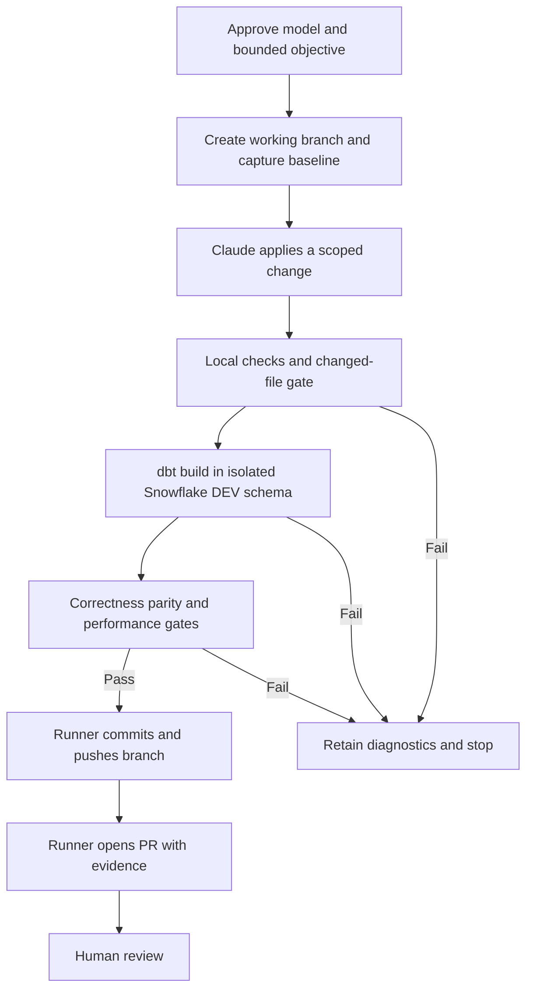

# claude -p harness

Runs `claude -p` headless with a bounded objective, a tool allowlist, a JSON schema, and a deterministic exit code. Python stdlib only.

## Run

    python3 run.py smoke                 # runner validation
    python3 run.py critical_path         # fixture-backed dbt critical path recommendation
    python3 run.py snowflake_profile     # same objective, data read live from Snowflake (read-only role)
    python3 run.py <workflow> [--cwd PATH] [--budget USD] [--timeout SEC]

Final stdout line: `run_id=<id> exit=<n> result=<path>`. Artefacts land in `runs/<run_id>/` (`argv.json`, `stdout.json`, `stderr.txt`, `result.json`, `summary.json`).

Tests (fake claude, no API calls): `python3 -m unittest discover -s tests -v`

## Exit codes

| Code | Meaning |
|---|---|
| 0 | Completed with schema-valid payload. Recommendation is on disk; stop for human. |
| 1 | claude failed: nonzero return, `is_error`, budget exhausted, or timeout. |
| 2 | claude ran but payload missing or schema-invalid. |
| 3 | Config error (workflow folder or file missing). |

## Safety

All flags live in `agent_runner/invoke.py:build_argv`: `--permission-mode dontAsk`, a per-workflow `--allowedTools` list when nonempty, write/web tools disallowed, `--max-budget-usd`, and a subprocess timeout. No `--bare`, no `bypassPermissions`. The harness does not use `--max-turns`; a separate GitHub headless test successfully used `--max-turns 1`.

`Read`, `Glob`, and `Grep` are also disallowed unless a workflow lists them.

**Permission rules are a guardrail, not a security boundary.** Claude Code auto-approves built-in read-only shell commands inside `--cwd` regardless of the `Bash(...)` allowlist. Tested on 2.1.308 with the exact `critical_path` argv: `cat probe.env` inside `--cwd` returned the file; `cat` outside `--cwd` was denied. `printenv VAR`, `env`, `echo $VAR`, and `cat /proc/self/environ` were all denied in the same setup, but treat that as observed behaviour of this version, not a guarantee. Rules:

1. Never place credentials (private key, `.env`, tokens) under `--cwd`.
2. Environment variables set for `run.py` are inherited by `claude` and its shell commands. Do not rely on env vars to hide secrets from the agent. Prefer a credential file outside `--cwd`, readable only by the tool's identity (separate OS user via `sudo -u`, or a secret store the agent's user cannot read).
3. Enforce least privilege at the target system (read-only Snowflake role, scoped dbt token). That is the control that holds if the permission rules fail. Verify it with real write probes, not one refused `CREATE DATABASE`: every role inherits `PUBLIC`, and on the trial account `PUBLIC` was granted `SNOWFLAKE_LEARNING_ROLE`, which let `CLAUDE_READONLY` create schemas and tables until it was revoked. Check `SHOW GRANTS TO ROLE PUBLIC`, then try `CREATE SCHEMA`, `CREATE TABLE`, `INSERT`, and `DELETE`. Known residual: with only `USAGE` on a schema, the role can still create session-scoped `TEMPORARY` tables. They vanish when the session ends and touch no persisted data.

## Snowflake setup (`snowflake_profile`)

`tools/snowflake_ro.py` runs one fixed query through `snow sql -c claude_ro`; its only input is an integer run id. It requires the Snowflake CLI (`snow`) on `PATH`, not a Python connector. The source table has no status column, so the tool reports `SUCCESS` when rows exist and `NOT_FOUND` otherwise.

Data: `DBT_DEMO.META.DBT_MODEL_TIMINGS`, loaded with the same five models as the `critical_path` fixture. This is a live Snowflake query over synthetic timings, not real dbt run metrics or query-plan profiling. The expected recommendation is `int_transactions`, on the chain `stg_events -> int_transactions -> fct_transactions -> rpt_finance`.

### Local authentication: key pair

Connection `claude_ro` in `~/.snowflake/connections.toml` (outside `--cwd`, `chmod 600`): key-pair auth (`SNOWFLAKE_JWT`) for a `TYPE = SERVICE` user `CLAUDE_SVC`, role `CLAUDE_READONLY`, warehouse `CLAUDE_WH`. The encrypted private key and passphrase stay outside the checkout. These local files are not committed or provisioned on GitHub runners.

### GitHub Actions authentication: OIDC

Verified on a GitHub-hosted Ubuntu runner with `snowflakedb/snowflake-actions@v3` (reported integration version v3.5.1). Snowflake authenticates GitHub's workload identity; no Snowflake private key or passphrase is required on the runner. Claude separately authenticates using the repository secret `CLAUDE_CODE_OAUTH_TOKEN`.

Registered on the Snowflake service user:

```sql
ALTER USER CLAUDE_SVC
ADD WORKLOAD IDENTITY github_actions
    TYPE = OIDC
    ISSUER = 'https://token.actions.githubusercontent.com'
    SUBJECT = 'repo:samabenojar@245874282/claude-agent-test@1435434978:ref:refs/heads/main';
```

That subject is specific to this repository and `main` branch. Other branch refs do not match it. Keep manual triggering and do not run untrusted pull-request code in a job with this identity.

The tested job uses `permissions: contents: read` and `id-token: write`, installs Claude Code, then configures Snowflake as follows:

```yaml
- name: Install Snowflake CLI and configure OIDC
  uses: snowflakedb/snowflake-actions@v3
  with:
    use-oidc: true
    oidc-token-name: SNOWFLAKE_CONNECTIONS_CLAUDE_RO_TOKEN

- name: Configure claude_ro Snowflake connection
  shell: bash
  env:
    SNOWFLAKE_ACCOUNT: ${{ secrets.SNOWFLAKE_ACCOUNT }}
  run: |
    set -euo pipefail
    mkdir -p "$HOME/.snowflake"
    cat > "$HOME/.snowflake/config.toml" <<EOF
    [connections.claude_ro]
    account = "${SNOWFLAKE_ACCOUNT}"
    user = "CLAUDE_SVC"
    role = "CLAUDE_READONLY"
    warehouse = "CLAUDE_WH"
    authenticator = "WORKLOAD_IDENTITY"
    workload_identity_provider = "OIDC"
    EOF
    chmod 600 "$HOME/.snowflake/config.toml"

- name: Test Snowflake connection
  shell: bash
  run: |
    set -euo pipefail
    snow connection test -c claude_ro
    snow sql -c claude_ro \
      -q "select current_user(), current_role(), current_warehouse();"

- name: Run snowflake_profile workflow
  shell: bash
  env:
    CLAUDE_CODE_OAUTH_TOKEN: ${{ secrets.CLAUDE_CODE_OAUTH_TOKEN }}
  run: |
    set -euo pipefail
    python3 run.py snowflake_profile --budget 1.00 --timeout 120

- name: Upload harness artefacts
  if: always()
  uses: actions/upload-artifact@v7
  with:
    name: claude-snowflake-profile-runs
    path: runs/
    if-no-files-found: warn
```

The OIDC action exports `SNOWFLAKE_CONNECTIONS_CLAUDE_RO_TOKEN`; it is inherited by `run.py`, Claude, and tool subprocesses. It is not hidden from the agent's process. Keeping configuration outside the checkout avoids ordinary repo reads, but is not OS-level credential isolation. Snowflake privileges remain the authorization boundary.

### Verification evidence

User-provided [GitHub Actions run](https://github.com/samabenojar/claude-agent-test/actions/runs/40475616531) completed successfully:

| Check | Observed result |
|---|---|
| Snowflake connection test | `Status OK`, user `CLAUDE_SVC`, role `CLAUDE_READONLY`, warehouse `CLAUDE_WH` |
| Harness run | `20261027T084814Z-54aad408`, exit `0` |
| Artefact upload | Five files uploaded as `claude-snowflake-profile-runs` |
| Downloaded `result.json` inspected | Run `847293`, `candidate_found`, recommended model `int_transactions`, expected four-model critical path |
| Run summary | Claude-reported cost USD `0.0251107`, duration `10694` ms (excludes Snowflake compute and job overhead) |

The downloaded ZIP was inspected: `result.json` matches the expected recommendation and chain, and `stdout.json` reports `is_error: false`. This verifies the answer, not which tool commands ran. The final `stdout.json` envelope contains no individual tool-call records; three turns and no permission denials do not prove tool usage. Use a separate `--output-format stream-json --verbose` invocation when that trace is needed.

Locally, the same workflow returned the expected model and chain; a separate stream-json run showed only the Snowflake tool command and the final structured-output tool. Persistent write probes against `DBT_DEMO` (`CREATE TABLE`, `INSERT`, `DELETE`, `CREATE SCHEMA`) were refused after removing the inherited learning role. Temporary-table creation remained permitted.

## Adding a workflow

Create `workflows/<name>/` with `workflow.json` (`{"allowed_tools": [...]}`), `prompt.md`, `schema.json`. The hand-rolled validator supports only `type`, `required`, `properties` primitive `type`, and `enum`.

## Future seams

- Real dbt Cloud API: add `tools/dbt_api.py` and list it in `allowed_tools`. Use a scoped read-only token, read from a credential file outside `--cwd` that only the tool's identity can read (see Safety rule 2).
- Real Snowflake profiling: extend beyond the implemented synthetic timings workflow to actual query history or query plans, with narrowly scoped read access. GitHub OIDC and local key-pair authentication are already verified.
- Automated dbt changes: see Future architecture below. Requires a real dbt project, deterministic validation gates, isolated DEV write access, and runner-controlled PR publication; not implemented.
- JAMS/VM wrapper: install Claude Code and the Snowflake CLI, provision authentication for that environment, run `python3 run.py <workflow> --cwd <checkout>`, and branch on its exit code. GitHub-hosted execution is verified; Azure/JAMS deployment and authentication remain untested. Do not assume GitHub's OIDC identity works on another scheduler.
- VM discard: delete the VM after collecting `runs/<run_id>/`.

## Future architecture: dbt optimization through a PR

**Proposed, not implemented.** Extend the recommendation-only harness into a code-changing workflow that ends at a PR for human review. The current `snowflake_profile` workflow remains read-only and unchanged. Publishing a PR is the completion boundary; automatic merge or production deployment is out of scope.



### Validation stages

For a bounded objective such as “optimize `int_transactions` without changing its results”:

1. **Baseline:** capture the original model's results and performance before editing, using a defined input snapshot and comparable execution conditions.
2. **Apply change:** let Claude edit only approved model files and related tests/configuration on a working branch. Reject changes outside that scope.
3. **Local/cheap checks:** run `dbt parse`, SQL/static checks, and genuinely offline fixture tests. Run `dbt compile` and applicable unit tests too, but do not assume they are offline: introspective macros and adapter-specific tests may query Snowflake.
4. **Live DEV build:** run `dbt build --select int_transactions+` against a per-run DEV schema. The trailing `+` includes downstream models, so their effects must also fit the approved scope and cost budget. Never target production.
5. **Correctness gate:** require dbt tests to pass and compare baseline/candidate results on the same inputs, including explicit handling of duplicates, nulls, and any permitted numeric tolerances.
6. **Performance gate:** require comparable baseline/candidate measurements and an agreed acceptance criterion. Passing `dbt build` alone proves neither parity nor an improvement.
7. **Publication:** only after every gate passes, have the runner commit, push the branch, and open a PR containing the evidence. On failure, retain diagnostics and stop without publishing a passing recommendation.

### Authority and implementation changes

| Area | Required change |
|---|---|
| Workflow | Add a separate editing workflow; do not expand the recommendation workflow's authority. |
| Checkout | Use the real dbt repository on a working branch, with protected files excluded from allowed edits. |
| Snowflake | Create a dedicated DEV writer role and isolated per-run schema. Keep `CLAUDE_READONLY` for recommendation queries. |
| Orchestration | Extend the runner with deterministic validation and publication stages; this is more than adding a workflow folder. |
| Publishing | Give only the publication stage branch-push and PR permissions. Prefer a separate job so Claude does not inherit those credentials; disable persisted checkout credentials in the editing job. |
| Evidence | Retain the patch, changed-file list, dbt results, parity comparison, performance measurements, and PR URL with the run artefacts. |
| Completion | Open PR and stop for human approval. Do not merge or deploy automatically. |

Claude proposes and edits; the runner executes checks and evaluates their actual outcomes. Claude's statement that tests passed is not a validation gate. Existing budget and subprocess timeouts must be complemented by bounded warehouse execution and isolated DEV access; a local process timeout must not be assumed to cancel a submitted Snowflake query.

### Prerequisites and open decisions

- A real dbt project containing `int_transactions`, with pinned dbt/adapter dependencies. The current demo creates Snowflake relations and synthetic timings, not dbt source files.
- The model SQL, business invariants, and a justified optimization objective. A timing ranking alone does not identify a safe change.
- Representative fixed inputs, baseline/candidate isolation, parity rules, and performance acceptance criteria.
- Narrow DEV grants, downstream build scope, warehouse cost limits, and cleanup of per-run schemas after evidence collection.
- Explicit failure outcomes and machine-readable artefacts for each gate before introducing this workflow; the current exit codes describe recommendation execution, not the full PR lifecycle.

